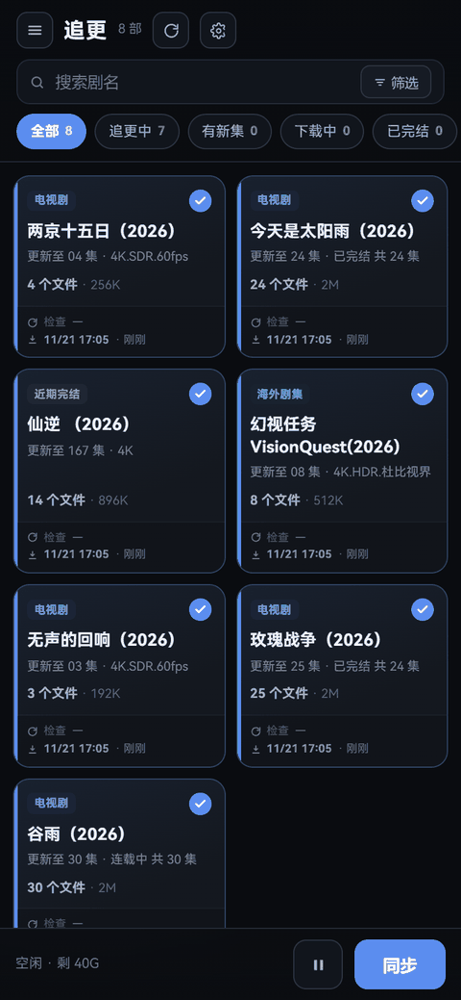
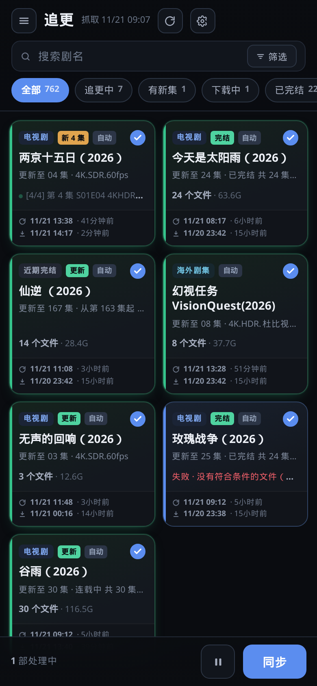
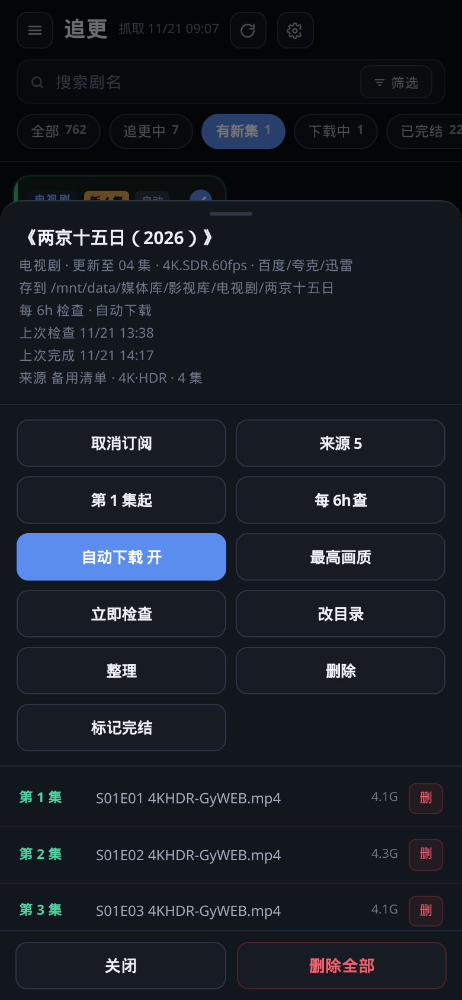
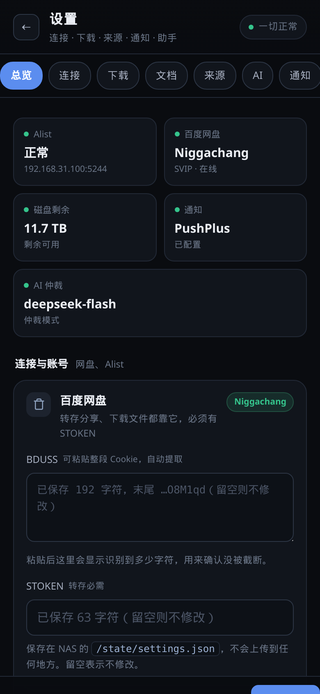
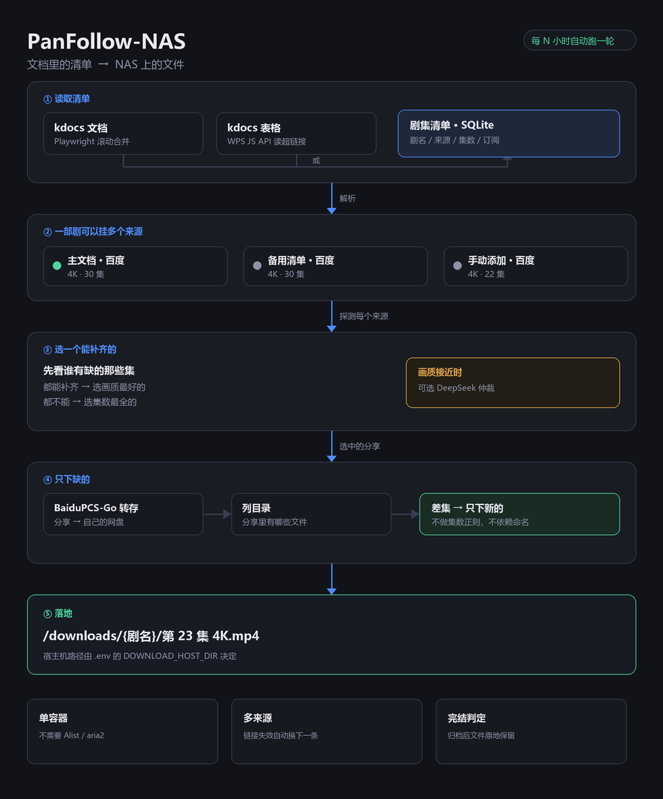

# PanFollow-NAS

[](https://github.com/leeaoon168-oss/panfollow-nas/actions/workflows/docker.yml)
[](https://github.com/leeaoon168-oss/panfollow-nas/actions/workflows/ci.yml)
[](https://github.com/leeaoon168-oss/panfollow-nas/pkgs/container/panfollow-nas)
[](https://github.com/leeaoon168-oss/panfollow-nas/releases)
[](LICENSE)
[-4FD3A0)](https://www.fnnas.com/)

[简体中文](README.md) · **English**

Turn a **share-list document** (kdocs / WPS Docs) into an automatic downloader for your NAS.

You keep a list of "title + cloud-drive share link" in a document. PanFollow-NAS reads it on a schedule,
downloads **only the episodes you don't have yet**, and notifies you in the mobile web app or via chat/email.

<p align="center">
  
</p>

<p align="center">
  
  
  
</p>

<p align="center">
  
</p>

<details>
<summary>Text-only version</summary>

```
┌──────────────── run once every N hours ────────────────┐
│                                                        │
│  kdocs doc  ──Playwright──▶  show list (SQLite)        │
│  kdocs sheet ─WPS JS API──▶  same, with real share URLs│
│                                 │                      │
│                    multiple sources per show           │
│                                 │                      │
│            probe + rank (quality / episodes / AI)      │
│                                 │                      │
│                        chosen share link               │
│                                 │                      │
│     BaiduPCS-Go transfer ──▶ list files ──▶ diff       │
│                                 │                      │
│                        download only the missing ones  │
│                                 ▼                      │
│                    /downloads/<show title>/            │
└────────────────────────────────────────────────────────┘
```

</details>

## Features

- **Reads both documents and spreadsheets**
  - Documents: headless Chromium via Playwright, scrolls and merges the virtualized list
  - Spreadsheets: talks to the WPS frontend API and reads cells by range, so it gets the
    **real hyperlinks** behind "百度网盘" cells (copy-paste only yields the display text)
- **Baidu and Quark both supported**
  - Baidu: transferred/downloaded inside the container by BaiduPCS-Go — no extra components
  - Quark: **probing needs no login** (share pages are guest-readable), so episode count and quality
    still take part in ranking; downloading needs a QR login in Settings, then Alist turns the share
    into a direct link and aria2 writes it to disk (Quark free tier is ~10 GB, so it transfers one
    episode, downloads it, then cleans up)
  - Xunlei / 139 / 115: links are parsed and shown, not downloaded yet
- **Multi-document merge**: the same show in several documents is merged; each source is tagged
  with the document it came from (`主文档` / `备用清单` …)
- **Source ranking**: a show can have many share links (authors rotate links over time).
  Every source is probed for quality and episode count, then ranked:
  - when episodes are missing, **"can complete the show" beats "higher quality"**
  - when quality is close, an optional **DeepSeek** call breaks the tie (any OpenAI-compatible model works)
  - dead links are marked and the next source is tried automatically
- **Only new episodes**: no episode-number regex — it diffs `files in the share` against
  `files on disk`, so it works regardless of naming conventions
- **Finished detection**: cells like `12集完结` or `04/30集` are parsed; one tap archives a finished show
  (stops following, keeps files untouched)
- **Notifications**: in-app banner + Android system notifications, plus PushPlus / WeCom / Email /
  ServerChan / Bark / generic webhook
- **Mobile-first web UI**: no build step, one HTML file, drawer navigation, per-show download folder,
  "new folder" directly in the folder picker
- **Android APK**: thin WebView shell + foreground service, so notifications arrive in the background

## Requirements

1. A NAS or Linux host running Docker (**single container — no Alist, no aria2**)
   - Developed and verified on **fnOS (飞牛)**; Synology, QNAP, TrueNAS and plain Linux work too,
     only the host paths differ
2. A **Baidu Netdisk SVIP** account (transfer and fast download both require a paid account)
3. (Optional) **Alist** — only needed to download **Quark** links: Quark does not hand out direct URLs
   for large files, so Alist mounts the Quark drive and proxies it. Skip it if you only use Baidu
4. Your own kdocs document or spreadsheet to use as the share list

> On fnOS: install Docker from the App Center → SSH into the NAS → the steps below.
> Use fnOS-style paths such as `/vol1/1000/...` for the download directory.

## Quick start

```bash
git clone https://github.com/leeaoon168-oss/panfollow-nas.git
cd panfollow-nas

cp .env.example .env
vi .env                       # 4 required values: DOC_URL / ALIST_BDUSS / ALIST_STOKEN / DOWNLOAD_HOST_DIR

docker compose up -d --build  # ~3-8 min (installs Chromium, downloads BaiduPCS-Go)
# open http://<NAS_IP>:8099
```

In mainland China the build can be slow; use mirrors:

```bash
PIP_INDEX_URL=https://pypi.tuna.tsinghua.edu.cn/simple \
PCS_MIRROR=https://ghfast.top/ \
docker compose up -d --build
```

**Prefer not to build?** GitHub Actions builds a multi-arch image on every push:

```bash
docker pull ghcr.io/leeaoon168-oss/panfollow-nas:latest
IMAGE=ghcr.io/leeaoon168-oss/panfollow-nas:latest docker compose up -d
```

> Step-by-step guide (how to grab BDUSS/STOKEN, build failures, choosing folders):
> **[docs/DEPLOY.md](docs/DEPLOY.md)** (Chinese).

After the first start:

1. Open `http://<NAS_IP>:8099/login` and scan the QR code to sign in to kdocs
2. In Settings, paste your Baidu `BDUSS` / `STOKEN`
3. In **Discover**, tick the shows you want → tap **Sync**

> `BaiduPCS-Go` (the downloader) is not vendored in this repo — it is **downloaded at image build time**
> (with automatic fallback to public mirrors). Pin a version or URL with
> `--build-arg PCS_VERSION=4.0.2` / `--build-arg PCS_URL=...`.

## Configuration

Everything lives in `.env`; re-run `docker compose up -d` after changes.

| Variable | Meaning | Required |
|---|---|---|
| `DOC_URL` | The document / spreadsheet acting as the share list | ✅ |
| `ALIST_BDUSS` | Baidu BDUSS | ✅ |
| `ALIST_STOKEN` | Baidu STOKEN (required for transferring) | ✅ |
| `DOWNLOAD_HOST_DIR` | Host download folder (mounted at `/downloads`) | ✅ |
| `DATA_HOST_DIR` | Host data root (mounted at `/mnt/data`, used by the folder picker) | ✅ |
| `DOC_COOKIE` | Fallback only; QR login is recommended | |
| `SYNC_HOURS` | Refresh interval in hours (default 24) | |
| `ALIST_URL` / `ALIST_USER` / `ALIST_PASS` / `ARIA2_SECRET` | Legacy, ignore on a fresh install | |

Other switches (AI, notifications, quality preference, disk guard) live in the web UI and are stored
in SQLite — no restart needed.

## Layout

```
app/            FastAPI service (backend + static pages)
  server.py     routes, scraping, source picking, download orchestration, notifications, SSE
  store.py      SQLite: shows / subs / sources / documents / policy
  kdocs.py      document parsing + share-link parsing
  sheet.py      spreadsheet TSV parsing
  sheetlinks.py cell + hyperlink extraction via the WPS frontend API
  ai.py         DeepSeek arbitration (falls back to rules on any failure)
  notify.py     notification channels
deploy/nas.py   tiny SSH deploy helper
android/        Android WebView shell (no keystore, no build artifacts)
docs/           architecture, deployment, troubleshooting
```

## FAQ

**`检测BDUSS有效性json解析出错` on Baidu login?**
BaiduPCS-Go's self-check endpoint got an HTML anti-bot page instead of JSON. The cookie is usually fine:
PanFollow-NAS re-checks with `pcs who` and continues if the session is alive. Only replace the BDUSS
when `pcs who` reports "not logged in".

**How does Quark work?**
Two separate things:

- **Probing needs no login** — Quark share pages are guest-readable, so episode count, quality and
  total size are computed and take part in source ranking
- **Downloading needs a login** — Settings → Connections → Quark → scan the QR code. Each episode is
  transferred to your own Quark drive, Alist exposes a direct link, aria2 writes it to disk, then the
  transfer is cleaned up (the free tier is ~10 GB, so it rolls one episode at a time)

So Quark downloading needs **Alist (configured in Settings) + the aria2 container**; Baidu-only setups
need neither.

**What about Xunlei / 139 / 115 links?**
They are parsed and displayed in the source panel, but not downloaded yet.

**Do I need Alist or aria2?**
No. All downloading is done inside the container by BaiduPCS-Go. Alist/aria2 from earlier versions are
now optional and only start with `docker compose --profile legacy up`.

**Will it delete my files?**
Only download fragments (`.BaiduPCS-Go-downloading`, all-zero stubs) and only when you tap **Delete**.
Archived (finished) shows never participate in any download flow, and their files stay where they are.

## Disclaimer

This project only moves files from **publicly shared links** onto your own disk. It does not host,
provide, or index any content. Make sure you have the right to download what you download, and comply
with the cloud provider's terms and your local laws. Use at your own risk.

## License

MIT
