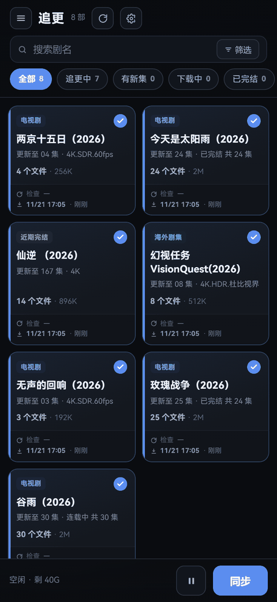
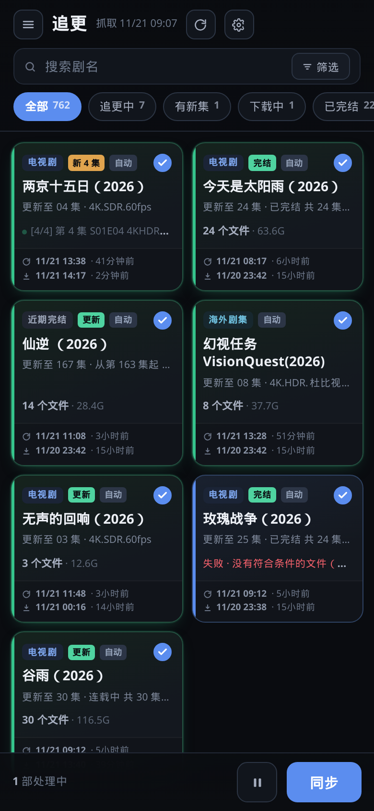
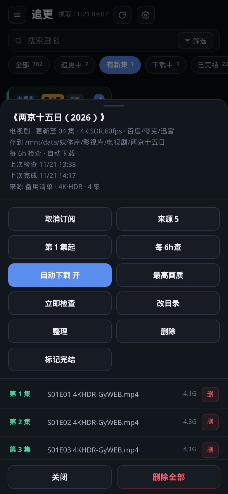
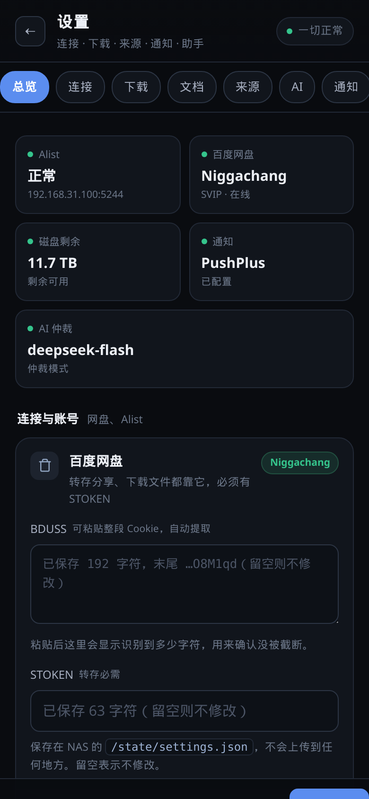
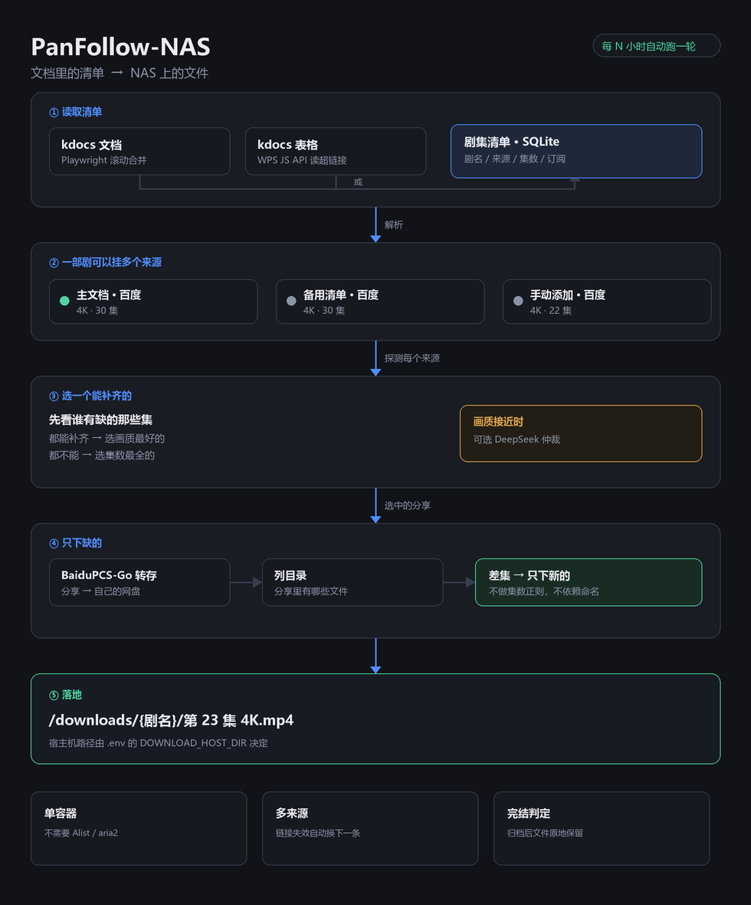

# PanFollow-NAS

[](https://github.com/leeaoon168-oss/panfollow-nas/actions/workflows/docker.yml)
[](https://github.com/leeaoon168-oss/panfollow-nas/actions/workflows/ci.yml)
[](https://github.com/leeaoon168-oss/panfollow-nas/pkgs/container/panfollow-nas)
[](https://github.com/leeaoon168-oss/panfollow-nas/releases)
[](LICENSE)
[](https://www.fnnas.com/)

**简体中文** · [English](README.en.md)

> 盘追 · 挂在 NAS 上，自动追网盘分享里的新集
> 仓库：`panfollow-nas`
把一份 **kdocs（金山文档）里的追更清单**，变成 NAS 上的自动下载器。

你在文档里维护"剧名 + 网盘分享链接"，这个服务定时读取它，把**本地还没有的集数**自动下载到 NAS 目录，并在手机 App / 微信里通知你。

<p align="center">
  
</p>

<p align="center">
  
  
  
</p>

<p align="center">
  
</p>

<details>
<summary>纯文字版（不方便看图时）</summary>

```
┌──────────────── 每 N 小时自动跑一轮 ────────────────┐
│                                                    │
│  kdocs 文档 ──Playwright──▶ 剧集清单（SQLite）      │
│  kdocs 表格 ──WPS JS API──▶ 同上（含真实分享链接）   │
│                              │                     │
│                    每个剧的多个「来源」              │
│                              │                     │
│              探测 + 排序（画质 / 集数 / AI 仲裁）    │
│                              │                     │
│                    选中的百度分享                   │
│                              │                     │
│         BaiduPCS-Go 转存 ──▶ 列目录 ──▶ 差集       │
│                              │                     │
│                        只下缺的那些集               │
│                              ▼                     │
│                    /downloads/<剧名>/               │
└────────────────────────────────────────────────────┘
```

</details>


## 特性

- **文档 / 表格两种来源都能读**
  - 文档：Playwright 驱动无头 Chromium，滚动合并虚拟列表
  - 表格：走 WPS 前端 API 按 Range 读单元格，能拿到单元格里的**真实超链接**（剪贴板方案只能拿到显示文字）
- **百度 + 夸克都能下**
  - 百度：容器内 BaiduPCS-Go 转存 / 下载，不需要额外组件
  - 夸克：**不登录也能探测**集数与画质（分享页游客可读）；要下载则在设置页扫码登录，
    由 Alist 转直链、aria2 落盘（夸克免费空间只有 ~10GB，所以是"转存单集 → 下载 → 删"滚动进行）
  - 迅雷 / 139 / 115 等：目前只记录链接、参与展示
- **多文档合并**：同一部剧出现在多份文档里会自动合并，链接按文档打标签（`主文档` / `备用清单` …）
- **多来源选优**：一部剧可以挂多个分享链接（同一个人隔段时间会换链接），自动探测每个来源的画质与集数后排序
  - 缺集时「**能补齐**」优先于「画质」
  - 画质接近时可选让 **DeepSeek** 仲裁，并可自定义模型
  - 链接失效自动标死链并换下一条重试
- **只下新增**：不做"集数正则解析"，而是 `分享目录文件 vs 本地已有文件` 做差集，天然只拿新集、不依赖命名规则
- **完结判定**：表格里写"12集完结"或"04/30集"时自动识别，可一键归档（停止追更、文件原地保留）
- **通知**：应用内横幅 + 系统通知（安卓 App）、PushPlus / 企业微信 / 邮件 / Server酱 / Bark / Webhook
- **手机优先的 Web UI**：无前端构建，单 HTML，抽屉导航、自定义下载目录、目录浏览时可直接新建文件夹
- **安卓 APK**：极薄 WebView 壳 + 前台服务，后台也能收通知

## 前置条件

1. 一台跑 Docker 的 NAS / Linux 主机（**只用百度时单容器即可**；要下夸克再加 Alist + aria2）
   - 本项目在 **飞牛 fnOS** 上开发与验证；群晖、威联通、TrueNAS、普通 Linux 同样可用（只是宿主机路径不同）
2. 一个**百度网盘 SVIP** 账号（转存和高速下载都要求会员）
3. （可选）**Alist**：只有要下载**夸克**链接时才需要——夸克不直接给大文件直链，
   要靠 Alist 挂「夸克网盘」驱动转一道；只用百度的话不用装
4. 一份你自己的 kdocs 文档或表格（当作追更清单）

> 在飞牛 fnOS 上：应用中心装好 Docker → SSH 进 NAS → 下面几步；
> 下载目录填 `/vol1/1000/...` 这类 fnOS 路径即可。

## 快速开始

```bash
git clone https://github.com/leeaoon168-oss/panfollow-nas.git
cd panfollow-nas

cp .env.example .env
vi .env                       # 填 4 项：DOC_URL / ALIST_BDUSS / ALIST_STOKEN / DOWNLOAD_HOST_DIR

docker compose up -d --build  # 约 3~8 分钟（装 Chromium + 下 BaiduPCS-Go）
# 打开 http://<NAS_IP>:8099
```

国内构建慢可以加加速：

```bash
PIP_INDEX_URL=https://pypi.tuna.tsinghua.edu.cn/simple \
PCS_MIRROR=https://ghfast.top/ \
docker compose up -d --build
```

**不想自己构建**：仓库自带 GitHub Actions，每次 push 会自动构建多架构镜像推到 GHCR。

```bash
docker pull ghcr.io/leeaoon168-oss/panfollow-nas:latest
IMAGE=ghcr.io/leeaoon168-oss/panfollow-nas:latest docker compose up -d
```

> 详细步骤（怎么拿 BDUSS/STOKEN、构建失败怎么办、目录怎么选）见
> **[docs/DEPLOY.md](docs/DEPLOY.md)**。

首次启动后：

1. `http://<NAS_IP>:8099/login` 扫码登录 kdocs
2. 设置页填百度 `BDUSS` / `STOKEN`
3. 「发现」里勾选要追的剧 → 「同步」

> 百度下载器 `BaiduPCS-Go` 不随仓库分发（体积大、分架构），
> **构建镜像时自动下载**（GitHub 失败会自动回退公共加速代理）；
> 要指定版本或地址：`--build-arg PCS_VERSION=4.0.2` / `--build-arg PCS_URL=...`。

## 配置

全在 `.env`，改完 `docker compose up -d` 生效。

| 变量 | 说明 | 必填 |
|---|---|---|
| `DOC_URL` | 追更清单文档/表格地址 | ✅ |
| `ALIST_BDUSS` | 百度 BDUSS | ✅ |
| `ALIST_STOKEN` | 百度 STOKEN（转存必须） | ✅ |
| `DOWNLOAD_HOST_DIR` | 宿主机下载目录（挂到容器 `/downloads`） | ✅ |
| `DATA_HOST_DIR` | 宿主机数据卷根目录（挂到 `/mnt/data`，用于选目录） | ✅ |
| `DOC_COOKIE` | 兜底用；推荐用扫码登录 | |
| `SYNC_HOURS` | 自动刷新清单的间隔（小时，默认 24） | |
| `ALIST_URL` / `ALIST_USER` / `ALIST_PASS` / `ARIA2_SECRET` | 早期版本遗留，新装可不填 | |

更多开关（AI、通知、画质偏好、磁盘保护）在网页「设置」里，存 SQLite，不用重启。

## 目录结构

```
app/            FastAPI 服务（后端 + 静态页面）
  server.py     路由、抓取、选源、下载编排、通知、SSE
  store.py      SQLite：shows / subs / sources / documents / policy
  kdocs.py      文档解析 + 分享链接解析
  sheet.py      表格 TSV 解析
  sheetlinks.py 表格单元格与超链接提取（WPS 前端 API）
  ai.py         DeepSeek 仲裁（失败自动回退规则）
  notify.py     通知渠道
deploy/nas.py   通过 SSH 部署到 NAS 的小工具
android/        安卓 WebView 壳源码（不含签名与产物）
docs/           架构、配置、排错
```

## 常见问题

**Q：百度登录报 `检测BDUSS有效性json解析出错`？**
这是 BaiduPCS-Go 自检接口被风控返回了 HTML，不代表账号失效。程序会用 `pcs who` 复核，
会话有效就继续。若 `pcs who` 也报未登录，才需要换 BDUSS。

**Q：夸克怎么用？**
分两件事：

- **探测（不用登录）**：夸克分享页游客可读，所以"多少集 / 什么画质 / 总共多大"能直接算出来，正常参与选优
- **下载（要登录）**：设置 → 连接与账号 → 夸克网盘 → 扫码。
  下载时把这一集转存到你自己的夸克网盘 → 由 Alist 的夸克驱动取直链 → aria2 落盘 → 删掉转存
  （aria2 没起也能下：会退回到容器内置的流式下载，同样支持断点续传）
  （夸克免费空间只有 ~10GB，所以是"转存一集 → 下载 → 清理"滚动进行）

因此**夸克下载需要 Alist（填在设置里）**；aria2 推荐但不强制（没起会走内置下载）。
只用百度的话两者都不需要。

**Q：迅雷 / 139 / 115 链接呢？**
会被解析出来、在来源面板里能看到，但暂不参与下载（和早期版本的夸克一样）。

**Q：需要另外装 Alist 或 aria2 吗？**
只用百度：不需要（下载全部由容器内的 BaiduPCS-Go 完成）。
要下夸克：需要 Alist（挂「夸克网盘」驱动，本程序会自动帮你建/更新这个挂载）+ aria2 容器
（`docker compose up -d` 默认就会起 aria2）。

**Q：会不会删我的文件？**
只会删"下载残片"（`.BaiduPCS-Go-downloading`、全零空壳）和手动点「删除」时。
标记完结（归档）后不再参与任何下载流程，文件原地保留。

## 免责声明

本项目只做"**把公开分享链接里的文件搬到自己的硬盘**"这件事，不提供、不托管、不搜索任何内容。
请确保你有权下载相关文件，遵守网盘服务条款与当地法律。使用者自行承担全部责任。

## License

MIT
